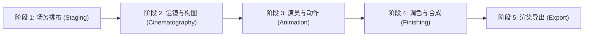
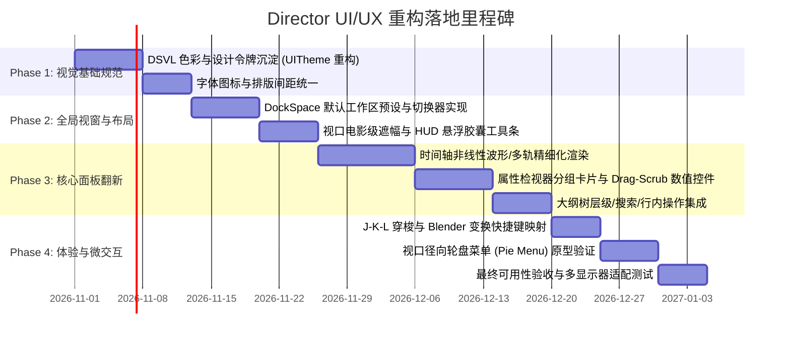

# Director 影视级动画编辑器 UI/UX 界面设计规范与系统设计文档
> **版本**：v1.0.0 | **日期**：2026-10-28 | **状态**：正式设计稿 (Official Design Spec)  
> **设计系统代号**：`Director Studio Visual Language (DSVL)`  
> **技术基底**：Minecraft Fabric 1.21.10 / Dear ImGui (imgui-mc / LWJGL3)

---

## 目录
1. [设计愿景与产品定位](#1-设计愿景与产品定位)
2. [用户画像与核心工作流 (User Journey)](#2-用户画像与核心工作流)
3. [设计系统与视觉规范 (DSVL Design Tokens)](#3-设计系统与视觉规范)
   - 3.1 色彩系统 (Color Palette & Semantic Tokens)
   - 3.2 字体排印与文本层级 (Typography)
   - 3.3 间距、圆角与布局网格 (Metrics & Rhythm)
   - 3.4 轨道与通道特征色彩规范 (Domain Colors)
   - 3.5 图标与符号系统 (Iconography)
4. [整体布局架构与工作区设计 (Workspaces)](#4-整体布局架构与工作区设计)
   - 4.1 全局视窗骨架 (Global Shell Layout)
   - 4.2 场景化工作区预设 (Task-Oriented Workspaces)
   - 4.3 独立双屏与视窗分离系统 (Detached Window Architecture)
5. [核心面板深度设计规范](#5-核心面板深度设计规范)
   - 5.1 顶部全局控制栏与工作区切换器 (Global Header & Workspace Bar)
   - 5.2 3D 视口与电影感 HUD 遮罩 (3D Viewport & Cinematic HUD)
   - 5.3 影视级非线性时间轴 (Pro Non-Linear Timeline & DopeSheet)
   - 5.4 场景与对象大纲视图 (Scene Outliner / Container Tree)
   - 5.5 上下文自适应智能属性检视器 (Contextual Inspector Panel)
   - 5.6 演员动画工坊与姿态库 (Actor Animation Studio & Pose Hub)
   - 5.7 天气、环境与动态灯光控制台 (Atmosphere & Lighting Studio)
   - 5.8 视听媒体导出与渲染队列中心 (Video Render & Export Modal)
6. [交互系统与微交互设计 (Interaction Patterns)](#6-交互系统与微交互设计)
   - 6.1 数值滚轮与手势微调 (Scrubbable Drag Controls)
   - 6.2 径向轮盘菜单 (Viewport Pie Menus)
   - 6.3 快捷键映射与肌肉记忆体系 (DCC Ergonomic Hotkeys)
   - 6.4 拖拽反馈、吸附对齐与状态提示
7. [技术实现指引 (ImGui-mc 落地指南)](#7-技术实现指引)
8. [演进路线与实施里程碑 (Roadmap)](#8-演进路线与实施里程碑)

---

## 1. 设计愿景与产品定位

### 1.1 设计愿景
Director 是 Minecraft 平台首个**对标工业级 DCC 软件（Blender / Unreal Sequencer / DaVinci Resolve）**的电影级动画摄制系统。
目前的 UI 属于“功能驱动的程序员界面”（信息密度失衡、控件层级扁平、视线引导弱、缺乏电影创作仪式感）。
本设计方案的核心理念是：
> **「将专业影视工具的严谨与沉浸，无缝融入 Minecraft 的体素美学之中。」**
- **低干扰，高沉浸**：让 3D 游戏取景视口成为主角，UI 界面悬浮或严谨停靠，半透明亚克力质感与精准的对比度相得益彰。
- **上下文驱动（Context-First）**：选中什么，面板就精准呈现什么；杜绝无意义的多层跳转。
- **肌肉记忆与高吞吐**：借鉴工业级 DCC 快捷键与拖拽习惯（Blender 式变换手势、Resolve 风格时间线编辑），提升创作者生产力。

### 1.2 目标用户群体
- **Machinima 电影创作者 / 剧情片导演**：需要精细机位轨迹、景深、光影氛围与精准的剪辑把控。
- **角色动画师 / 模型制作者**：需要直观的骨骼 FK/IK 调试、关键帧律动、动作库重用与表情打磨。
- **内容创作者 / YouTube & Bilibili UP 主**：需要快捷的运镜录制、即开即用的预设、一键导出高清视频或 Shorts 短视频。

---

## 2. 用户画像与核心工作流



| 创作阶段 | 核心任务 | 用户主要注视区域 | 关键 UI 痛点与解决方案 |
|---|---|---|---|
| **场务排布 (Staging)** | 摆放演员实体、道具、设定场景容器、架设局部补光灯 | 3D 视口中央、左侧大纲树 | 痛点：列表过深找不到演员。<br>**解法**：大纲树增加类型图标过滤、快速搜索与一键聚焦。 |
| **运镜构图 (Camera)** | 样条轨迹打点、安全框检查、焦距/景深调整、视点 Look-At | 3D 视口（安全框以内）、时间线机位轨 | 痛点：安全框与画面缺乏边界感。<br>**解法**：电影级遮幅（CinemaScope 2.39:1）、三分网格 HUD、焦距交互标尺。 |
| **角色动作 (Animation)** | 骨骼姿态 Pose、关键帧曲线、行走路径、Live 动作录制 | 底部时间线 DopeSheet、右侧骨骼变换 | 痛点：打帧操作繁琐，缺少动作库可视化。<br>**解法**：缩略图式姿态库、自动打帧（Auto-Key）悬浮指示、三轴色彩编码。 |
| **剪辑修饰 (Finishing)** | 音频对齐、天气/时间过渡曲线、滤镜/后处理混合 | 底部多轨时间轴、环境控制台 | 痛点：无法清晰感知多轨道相对时间关系。<br>**解法**：彩色轨道头部、波形预览、时间码标尺、吸附标记。 |
| **渲染输出 (Export)** | 预览回放、分辨率与码率设置、离线高清逐帧渲染 | 导出弹窗、进度渲染 HUD | 痛点：渲染中途黑屏或缺乏进度直观反馈。<br>**解法**：画中画逐帧渲染实时预览、剩余时间估算、片段标记导出。 |

---

## 3. 设计系统与视觉规范 (DSVL Design Tokens)

### 3.1 色彩系统 (Color Palette & Semantic Tokens)
采用低饱和、高对比的**影视级深灰黑调（Cinematic Dark Slate）**，降低视觉疲劳，确保 3D 画面中的 Minecraft 光影色彩不被 UI 抢夺注意力。

```
┌────────────────────────────────────────────────────────┐
│  DSVL 层次底色系统 (Surface Levels)                    │
│                                                        │
│  Base-00 (视口透明区)  : rgba(0, 0, 0, 0)              │
│  Base-01 (主窗体工作区): #121316 (rgba: 18, 19, 22)   │
│  Base-02 (容器面板背板): #1A1B1F (rgba: 26, 27, 31)   │
│  Base-03 (卡片与输入槽): #24262C (rgba: 36, 38, 44)   │
│  Base-04 (悬浮与活动态): #2E313A (rgba: 46, 49, 58)   │
└────────────────────────────────────────────────────────┘
```

#### 基础色彩变量规范表
| Token 标识符 | 颜色十六进制 (HEX/RGBA) | 用途说明 |
|---|---|---|
| `bg.surface.canvas` | `#121316` (0.94 Alpha) | 停靠面板的基础背景，兼具深沉与半透毛玻璃质感 |
| `bg.surface.panel` | `#1A1B1F` (0.96 Alpha) | 子窗口、子列表、参数分组卡片背景 |
| `bg.input.default` | `#24262C` | 输入框、下拉菜单、滑动条底槽基础态 |
| `bg.input.hover` | `#2E313A` | 输入组件悬停高亮态 |
| `bg.input.active` | `#383C47` | 输入组件激活、正在拖拽或正在输入态 |
| `border.subtle` | `#2C2F38` (0.60 Alpha) | 面板之间的分割线、卡片微弱描边 |
| `border.focus` | `#4B89FF` | 控件聚焦描边、当前选中的轨道/卡片描边 |
| `accent.primary` | `#3D78E6` | 核心主操作色（播放、提交、确认、活动 Tab） |
| `accent.hover` | `#548DFF` | 交互元素 Hover 亮色 |
| `accent.active` | `#2A62CC` | 交互元素 Pressed/Active 深色 |
| `status.success` | `#34C759` | 录制完成、导出成功、有效绑定指示灯 |
| `status.warning` | `#FF9F0A` | 帧率丢损警告、骨骼未绑定、覆盖提示 |
| `status.danger` | `#FF453A` | 关键帧删除、轨道清除、录制中高亮脉冲点 |
| `text.primary` | `#F2F4F8` | 核心标题、数值、活动文本（高可读性） |
| `text.secondary` | `#9BA1B0` | 标签说明、次要属性名、快捷键提示 |
| `text.disabled` | `#585D6B` | 禁用项、占位说明、未激活状态文本 |

### 3.2 字体排印与文本层级 (Typography)
- **UI 无衬线字体**：Inter / Segoe UI / PingFang SC（清晰现代的几何特征）
- **等宽与数值字体**：JetBrains Mono / Roboto Mono（用于时间码、帧编号、XYZ 坐标轴浮点数）
- **图标字体**：`assets/director/fonts/director.ttf` (扩充常用剪辑与变换矢量符号)

| 层级名称 | 字体尺寸 | 字重 (Weight) | 适用场景 |
|---|---|---|---|
| **Display H1** | 16px | SemiBold (600) | 模态弹窗主标题、工作区主导航 |
| **Panel Title** | 13px | SemiBold (600) | 面板标题栏（大写追踪字母间距 +0.5px） |
| **Body Bold** | 12px | Medium (500) | 控件标签、按钮文本、树节点名称 |
| **Body Regular** | 12px | Regular (400) | 下拉菜单选项、常规参数提示 |
| **Mono Metric** | 11px | Mono Regular (400) | 坐标 `X: 124.50`、时间码 `00:03:12:08` |
| **Caption / Hotkey**| 10px | Medium (500) | 快捷键徽章 `Ctrl+Z`、小脚标提示 |

### 3.3 间距、圆角与布局网格 (Metrics & Rhythm)
- **8px 基线网格（8-Point Grid System）**：所有间距采用 4px、8px、12px、16px、24px 阶梯。
- **圆角规范**：
  - 小控件（按钮、输入框、滑块）：`4px`
  - 浮动面板、HUD 胶囊、模态弹窗：`8px`
  - 标签 Pill、状态徽章：`12px` (全圆角)
- **触摸/点击热区保证**：时间轴手柄最小宽度 `8px`，按钮最小高 `24px`，避免点击漂移。

### 3.4 轨道与通道特征色彩规范 (Domain Colors)
在复杂的非线性多轨和 3D 变换中，使用统一的行业色彩约定，用户无需阅读文字即可瞬间识别上下文：

```
🔴 X 轴 / 红  : #E5484D (平移X、偏航Yaw、红色通道)
🟢 Y 轴 / 绿  : #46A758 (平移Y、俯仰Pitch、高度通道)
🔵 Z 轴 / 蓝  : #0091FF (平移Z、翻滚Roll、深度通道)
🟡 相机轨道   : #F5A623 (Amber 琥珀金 - 象征镜头与取景器)
🟣 演员/骨骼  : #AB47BC (Amethyst 紫晶 - 象征角色与骨骼姿态)
🟢 音频轨道   : #10B981 (Emerald 翡翠绿 - 象征声波与音乐)
🔷 环境/天气  : #00BCD4 (Cyan 天蓝 - 象征时间流逝与风雨)
🟠 实体动画   : #FF7043 (Coral 珊瑚橙 - 象征方块变换与物理事件)
```

---

## 4. 整体布局架构与工作区设计 (Workspaces)

### 4.1 全局视窗骨架 (Global Shell Layout)
整个界面遵循现代化 DCC 的停靠规范，中央为纯净透明的 Minecraft 3D 取景视口，周围环绕模块化 DockSpace：

```
+---------------------------------------------------------------------------------------------+
|  [D] DIRECTOR  | 🎬 运镜导演  🧍 角色动画  ⏱ 剪辑混音  ⚙ 环境渲染 |  项目: Shot_01* [💾] [↩][↪]  |
+----------------------+-------------------------------------------------+--------------------+
|  场景大纲 (OUTLINER) |                                                 |  属性检视 (INSPECT)|
|  ------------------  |                                                 |  ----------------  |
|  🔍 搜索对象...      |                                                 |  🎯 电影相机 #01   |
|  ▼ 🎬 场景容器_主场  |                                                 |  ----------------  |
|    ► 📷 轨道机位 A   |               MINECRAFT 3D VIEWPORT             |  ▼ 变换 (Transform)|
|    ▼ 🧍 亚历克斯     |             (透明渲染区 / 可交互取景)           |   X [ 102.40 ] 🔴  |
|      ► 🦴 头部/注视  |                                                 |   Y [  64.00 ] 🟢  |
|      ► 🦴 手臂/道具  |        ┌───────────────────────────────┐        |   Z [ -48.15 ] 🔵  |
|    ► 💡 暖色点光源   |        │      [ 16:9 安全框 HUD ]      │        |  ▼ 镜头参数 (Lens) |
|    ► 🎵 环境音效.wav |        │   +-------+-------+-------+   │        |   焦距: [ 50mm ]   |
|                      |        │   |       |       |       |   │        |   光圈: [ f/2.8]   |
|                      |        │   +-------+-------+-------+   │        |   景深: [ 启用 ]   |
|                      |        └───────────────────────────────┘        |   对焦: [ 目标跟随]|
+----------------------+-------------------------------------------------+--------------------+
|  [⏮][◀][ ▶/⏸ ][▶][⏭] [⏺ AUTO] [ 00:02:14:18 / 120f ] [ 24 FPS ] [ 🧲 吸附 ] [ 🔍 100% ]          |
|  -----------------------------------------------------------------------------------------  |
|  ⏱ 时间轴 (TIMELINE)                                                                        |
|  📷 [S][M][🔒] 运镜主轨 : ◆───────◆────────────────◆─────────────────◆                     |
|  🧍 [S][M][🔒] 亚历克斯 : [   跑动过渡动画   ]           [ 拔刀挥砍动作预设 ]               |
|  🎵 [S][M][🔒] 背景音乐 : ▃▅▇█▇▆▅▃ ▂▃▅▆▇▆▅▃▂    ▂▃▅▆▇█▇▆▅▃▂                                |
+---------------------------------------------------------------------------------------------+
|  就绪 | 选区: 摄像机_01 (Keyframe #3) | 光标: X:102 Y:64 Z:-48 | 内存: 184MB | FPS: 120.4       |
+---------------------------------------------------------------------------------------------+
```

### 4.2 场景化工作区预设 (Task-Oriented Workspaces)
顶部预置 4 套根据实际创作任务定制的 Dock 布局，支持一键无缝切换：

#### 工作区 A：🎬 运镜导演工作区 (Cinematography Workspace)
- **核心重点**：最大化 3D 视口。
- **左侧**：精简机位列表与镜头库。
- **右侧**：相机专精属性（焦距、感光元件、景深 DoF、运动模糊、抖动模拟）。
- **底部**：单轨/双轨机位时间线，突出样条曲线（Curve Editor）与过渡手柄。

#### 工作区 B：🧍 角色动画工坊 (Actor Studio & Rigging)
- **核心重点**：人体工学骨骼调试与动作序列打磨。
- **左侧**：演员层级与骨架树（Head, Torso, Limbs, Props），带独立姿态库（Pose Library）。
- **右侧**：IK/FK 切换滑块、约束目标选择器（Look-At、Hold-Item）、动作混合权重。
- **底部**：多通道 DopeSheet（展开每根骨骼的平移、旋转分量），配备 Auto-Key 录制。

#### 工作区 C：⏱ 剪辑混音工作区 (NLE Sequencing & Sound)
- **核心重点**：时间关系与视音频同步。
- **视口**：缩小为画中画（PIP）预览监视器。
- **下半部分**：占据屏幕 60% 高度的专业非线性剪辑台，展示音频波形轨、天气渐变轨、多镜头切镜轨（Shot Director Track）。

#### 工作区 D：⚙ 环境与后期渲染 (Environment & Finishing)
- **左侧**：动态天空盒与时间流速控制器、点光源/聚光灯层级。
- **右侧**：后期滤镜（LUT 调色、暗角、辉光 Bloom、体积雾色）。
- **浮动窗口**：离线高质量渲染导出队列。

### 4.3 独立双屏与视窗分离系统 (Detached Window Architecture)
针对专业多显示器创作者，支持将 Director 界面彻底解耦：
- **屏幕 1 (主显示器)**：完全纯净的 Minecraft 全屏游戏画面，保留极简的安全框线与 3D Gizmo，无任何 UI 遮挡。
- **屏幕 2 (副显示器)**：运行独立的 OS 原生外置窗口（基于 LWJGL Secondary Window），承载全功能时间线、调色盘、大纲树与属性栏，实现准专业级电影工作站体验。

---

## 5. 核心面板深度设计规范

### 5.1 顶部全局控制栏与工作区切换器 (Global Header & Workspace Bar)
全局控制栏采用高度紧凑的 **36px 高度**设计，是整个编辑器的中枢枢纽：

```
+-------------------------------------------------------------------------------------------------------------+
| [🎬 DIR]  文件(F) 编辑(E) 查看(V) 窗口(W) 帮助(H) | [ 运镜导演 | 角色工坊 | 剪辑混音 | 环境调色 ] | [Shot_02]* [💾] [↩][↪] | [🚀 导出] [⛶ 浮窗] |
+-------------------------------------------------------------------------------------------------------------+
```
1. **品牌与主菜单**：左上角 `[🎬 DIR]` 标识，集成了标准的 Desktop 风格菜单项，并附带明确的快捷键提示（如 `Ctrl+N` 新建场景，`Ctrl+S` 快速保存）。
2. **工作区胶囊切换器 (Workspace Segmented Control)**：居中放置，高亮状态为背景药丸状蓝色滑块（带 150ms 弹性过渡动效）。
3. **工程状态信息与安全保障**：
   - 当前场景名显示（例如 `Desert_Chase_Scene`），一旦有未保存修改即显示琥珀色微小星号 `*`。
   - 自动保存脉冲指示器（浅绿微光提示最近一次 Auto-Save 时间）。
4. **快速操作按钮组**：右侧常驻 `[↩ 撤销]`、`[↪ 重做]`、`[🚀 导出视频]` 与 `[⛶ 双屏独立窗口]`。

---

### 5.2 3D 视口与电影感 HUD 遮罩 (3D Viewport & Cinematic HUD)
3D 视口不是冰冷的画面，而是导演的取景器。

```
┌─────────────────────────────────────────────────────────────┐
│ 📷 Camera_01  •  50mm  f/2.8  ISO 100  [REC ● 00:01:24:12]   │
│ ┌─────────────────────────────────────────────────────────┐ │
│ │  +-----------------+-----------------+----------------+ │ │
│ │  |                 |                 |                | │ │
│ │  |                 |        ┼        |                | │ │
│ │  |                 |                 |                | │ │
│ │  +-----------------+-----------------+----------------+ │ │
│ │  |      [ 90% Action Safe ]                           | │ │
│ │  +-----------------+-----------------+----------------+ │ │
│ └─────────────────────────────────────────────────────────┘ │
│ [ 🎯 视口悬浮工具条: (Q)选择 (W)移动 (E)旋转 (R)缩放 (T)注视点 ]   │
└─────────────────────────────────────────────────────────────┘
```

#### 5.2.1 电影遮幅与安全框系统 (Safe Frames)
- **CinemaScope 遮幅蒙版**：支持 2.39:1 (宽银幕电影)、16:9 (标准影视)、9:16 (竖屏短视频) 动态黑边遮幅（遮幅外画面提供 0%~80% 可调透明暗度）。
- **构图参考辅助线**：
  - **三分法则 (Rule of Thirds)**：金色细线分割视口，交点采用微十字标记。
  - **黄金螺旋 (Golden Ratio Spiral)**：快捷键反转螺旋方向。
  - **动作安全区 (Action Safe 90%)** 与 **字幕安全区 (Title Safe 80%)**：虚线微光勾边，防止关键画面贴边穿帮。
- **景深对焦平面 (Focus Plane Visualizer)**：开启景深时，3D 视口中以半透明翠绿微光网格显示实际焦点平面位置，调节焦距时实时切分景深范围。

#### 5.2.2 视口快捷悬浮胶囊工具栏 (Floating Viewport HUD)
- 常驻于视口顶部中央或底部中央，支持一键切换变换工具：
  - `[↖ 选择(Q)]` `[✥ 平移(W)]` `[🔄 旋转(E)]` `[📐 缩放(R)]` `[👀 注视(T)]`
  - 局部/全局坐标系切换：`[🌐 Global / 📦 Local]`
  - 表面吸附开关：`[🧲 贴地吸附 (Snap to Terrain)]`

---

### 5.3 影视级非线性时间轴 (Pro Non-Linear Timeline & DopeSheet)
时间轴是 Director 的心脏。本案彻底重构目前过于紧凑的时间轴面板，将其升级为工业级 NLE 体验。

```
+-----------------------------------------------------------------------------------------------------------------+
| [⏮ 0f] [◀ 1f] [ ▶ 播放 (Space) ] [▶ 1f] [⏭ End] | [⏺ 自动打帧] [🧲 磁性吸附] | 帧率: [ 24 FPS ▼ ] | 缩放: [ ━●━━━ ]  |
| 当前时间: [ 00:00:04:18 ] ( 114 帧 )        入点: [ 0 ]   出点: [ 240 ]   总长: 10.0 秒                        |
+----------------------+------------------------------------------------------------------------------------------+
| 轨道列表 (Tracks)    | 0s       1s        2s        3s        4s        5s        6s        7s        8s        9s  |
| 🔍 搜索轨道...       | 0        24        48        72        96        120       144       168       192       216 |
|                      | ├──┼──┼──┼──┼──┼──┼──┼──┼──┼──┼──┼──┼──▼──┼──┼──┼──┼──┼──┼──┼──┼──┼──┼──┼──┼──┼──┼──┼──|
| ▼ 📷 主机位轨道      |                      ◆                 ◆         ◆                                       |
|    平移 X/Y/Z        | ═════════════════════◆═════════════════◆═════════◆═══════════════════════════════════════|
|    视场 FOV          | ─────────────────────◆───────────────────────────◆───────────────────────────────────────|
| ▼ 🧍 角色_史蒂夫     |                                                                                          |
|    ► 🏃 跑动位移     |       [===================== 基础奔跑循环 ====================]                          |
|    ► ⚔ 攻击片段     |                                                          [==== 挥刀跳砍 ====]            |
| ▼ 🎵 电影原声轨      |                                                                                          |
|    Vol: 80% [S][M]   | ▃▅▇█▇▆▅▃ ▂▃▅▆▇▆▅▃▂    ▂▃▅▆▇█▇▆▅▃▂       ▃▅▇█▇▆▅▃ ▂▃▅▆▇▆▅▃▂    ▂▃▅▆▇█▇▆▅▃▂                 |
+----------------------+------------------------------------------------------------------------------------------+
```

#### 5.3.1 播放控制条与传输中枢 (Transport Bar)
- **时间码与帧数双重显示**：左侧提供大字号 `00:01:23:14` (SMPTE) 与 `142 Frames`，支持点击直接键入绝对时间快速跳转。
- **J-K-L 专业快捷穿梭**：
  - 按 `L` 键依次倍速前进（1x -> 2x -> 4x -> 8x）。
  - 按 `J` 键依次倒放。
  - 按 `K` 键瞬时刹车制动。
- **自动关键帧指示灯 (Auto-Keying Indicator)**：开启时显示醒目的红色发光边框，提醒用户当前任何视口拖拽均会写入关键帧，避免误操作。

#### 5.3.2 轨道层级与头部控件 (Track Header Anatomy)
每个轨道头部包含清晰的模块化分区（固定宽度 240px，支持拖拽边缘调整）：
1. **展开折叠三角 (Disclosure Chevron)**：展开子通道（如位置、旋转、骨骼通道）。
2. **类别色条 (Category Strip)**：左侧 4px 竖条标示轨道属性（如相机金、角色紫、音频绿）。
3. **轨道类型图标与名称**：双击即可在行内重命名。
4. **控制按钮群**：
   - `[👁 / 🕶]`：可见性开关。
   - `[🔒]`：轨道锁定（禁止改动）。
   - `[S]` (Solo) 与 `[M]` (Mute)：独奏/静音控制。
   - `[⏺]`：通道打帧使能。

#### 5.3.3 关键帧与片段视觉规范 (Keyframes & Clips)
- **关键帧图形语意**：
  - 纯菱形 `◆`：线性插值 (Linear)。
  - 平滑圆角菱形 `◇`：贝塞尔平滑缓动 (Bezier / Ease In-Out)。
  - 方块 `■`：定格保持插值 (Constant / Hold)。
- **音频波形实时渲染**：采用轻量峰值缓存，利用 ImDrawList 绘制平滑的半透明音频波形，并以红色细竖线实时标示音画踩点拍点。

---

### 5.4 场景与对象大纲视图 (Scene Outliner / Container Tree)
大纲视图是管理整个复杂影视项目的总览地图：

```
+-------------------------------------------------------+
| 场景大纲 (OUTLINER)                    [ ➕ 添加 ] [ ⚙ ] |
| ----------------------------------------------------- |
| 🔍 快速过滤 (名称/类型/Tag)...                [ 过滤 ▼ ]|
| ----------------------------------------------------- |
| ▼ 📁 场景容器: Act1_VillageAttack                      |
|   ▼ 🎬 机位编组 (Cameras)                             |
|     📷 Cam_MainShot [主镜头]                   👁  🔒  |
|     📷 Cam_CloseUp_Steve [特写]                👁  🔒  |
|   ▼ 👥 角色群 (Actors)                                |
|     ▼ 🧍 Steve [主角]                          👁  🔒  |
|       🦴 Head (注视: Cam_MainShot)                     |
|       🦴 RightArm (持物: Diamond_Sword)               |
|     ► 🧟 Zombie_Horde [丧尸群组 (8人)]          👁  🔒  |
|   ▼ 💡 灯光与道具 (Props & FX)                        |
|     💡 PointLight_Campfire (暖橙 3500K)         👁  🔒  |
|     📦 Particle_Smoke_Emitter                  👁  🔒  |
+-------------------------------------------------------+
```
- **行内极简操作**：鼠标悬停任意行时，自动浮现快速眼球（显示/隐藏）、锁头（锁定）与聚焦按钮。
- **层级拖拽排布**：支持拖动实体挂载到相机（如让角色作为相机的 Look-At 目标），或将武器道具直接拖拽吸附到角色的右手骨骼。
- **状态高亮同步**：在 3D 视口点击角色，大纲树自动展开并平滑滚动到该项；反之亦然。

---

### 5.5 上下文自适应智能属性检视器 (Contextual Inspector Panel)
告别杂乱冗长的单一表单，采用**分组卡片折叠 + 紧凑数字滑动条**体系：

```
+-------------------------------------------------------+
| 属性检视 (INSPECTOR)                  对象: [ 📷 Cam_01 ]|
| ----------------------------------------------------- |
| ▼ 变换与空间位置 (Transform)              [ 🌐 世界坐标 ]|
|   平移  X [ 102.50 ]  Y [  64.20 ]  Z [ -15.80 ]  [↺]|
|   旋转  P [ -12.0° ]  Y [ 145.5° ]  R [   0.0° ]  [↺]|
| ----------------------------------------------------- |
| ▼ 电影镜头属性 (Cinematic Lens)                        |
|   焦距预设: [ 35mm (广角人文)                      ▼ ] |
|   焦距数值: ──[ 35.0 mm ]──────────────●─────── [ 24-85] |
|   光圈值  : [ f/1.8 (大光圈虚化)                   ▼ ] |
|   对焦模式: (●) 手动距离   ( ) 跟踪目标实体              |
|   对焦距离: ──[ 4.50 米 ]────────●──────────── [ 0-50m] |
| ----------------------------------------------------- |
| ▼ 景深与镜头特技 (Post Effects)                       |
|   [✔] 启用景深模糊 (Depth of Field)                    |
|   [✔] 变形宽荧幕镜头光晕 (Anamorphic Bokeh)            |
|   暗角强度: ──[ 25% ]─────────●────────────────        |
+-------------------------------------------------------+
```

#### 5.5.1 数值输入框交互细节 (Scrubbable Inputs)
- **点击即修改**：单击数字框直接敲键盘输入精确值，支持公式计算（如键入 `+10` 或 `*2`）。
- **拖拽滑动 (Drag-Scrubbing)**：鼠标按住数字标签向左/向右拖拽，数值随灵敏度平滑增减；按住 `Shift` 键实现 0.1x 微调，按住 `Ctrl` 实现整数步进吸附。
- **一键复位按钮 `[↺]`**：当参数偏离默认值时，右侧出现微小复位按钮，点击恢复默认值。

---

### 5.6 演员动画工坊与姿态库 (Actor Animation Studio & Pose Hub)
专为 Minecraft 动画师量身定做的人体工程学面板：

```
+-------------------------------------------------------+
| 演员工坊 (ACTOR STUDIO)             当前: [ 🧍 亚历克斯 ]|
| ----------------------------------------------------- |
| [ 姿态预设库 (Poses) ]  [ 动作片段 (Clips) ]  [ 骨骼层级 ] |
| ----------------------------------------------------- |
| 🔍 搜索姿态...                         [ ➕ 保存当前姿态 ]|
| ┌─────────┐ ┌─────────┐ ┌─────────┐ ┌─────────┐       |
| │  [图]   │ │  [图]   │ │  [图]   │ │  [图]   │       |
| │ 标准站立 │ │ 拔刀戒备 │ │ 奔跑冲刺 │ │ 倒地受伤 │       |
| └─────────┘ └─────────┘ └─────────┘ └─────────┘       |
| 双击应用 | 混合权重: ──[ 100% ]──────●── (支持部分过渡)   |
| ----------------------------------------------------- |
| ▼ 逆向动力学与注视控制 (IK & Look-At)                  |
|   注视目标: [ 📷 主相机 (Cam_01)                   ▼ ] |
|   注视强度: ──[ 85% ]──────────────●─── [ 头部+躯干配合]|
|   手臂 IK : [✔] 开启双手武器吸附                       |
+-------------------------------------------------------+
```
- **可视化姿态库 (Pose Thumbnail Grid)**：将常用的战斗、待机、行走姿态渲染为 64x64 微型体素缩略图，动画师直接点击即可给当前时间点拍上姿态关键帧。
- **混合滑动条 (Pose Blend Slider)**：在现有姿态与目标预设之间随意滑动比例（0%~100%），轻松制作丝滑转场过渡。

---

### 5.7 天气、环境与动态灯光控制台 (Atmosphere & Lighting Studio)
掌控场景的宏观氛围与微观灯光：

```
+-------------------------------------------------------+
| 环境与灯光 (ATMOSPHERE & LIGHTS)                        |
| ----------------------------------------------------- |
| ▼ 天空与世界时间 (World Time & Sky)                    |
|   时刻调节: [ 🌇 黄昏日落 (12500)                  ▼ ] |
|   日夜时间: ───●──────────────────────── [ 0 - 24000 ] |
|   锁定时间: [✔] 播放时保持时间静止                      |
| ----------------------------------------------------- |
| ▼ 动态气候演变 (Weather Timeline)                      |
|   当前气候: 晴朗无云  ───▶  下雨打雷 (在 00:03 秒处渐变)|
|   雨雪强度: ──[ 60% ]──────────●──────                 |
| ----------------------------------------------------- |
| ▼ 场景灯光矩阵 (Scene Lights)              [ ➕ 放置光源 ]|
|   💡 [✔] 篝火暖光  | 点光源 | #FF8C32 | 强度: 8.5 | 阴影: 开|
|   💡 [✔] 洞穴冷光  | 聚光灯 | #328CFF | 强度: 3.2 | 阴影: 关|
+-------------------------------------------------------+
```

---

### 5.8 视听媒体导出与渲染队列中心 (Video Render & Export Modal)
将影视作品无缝导出为高质量视听成品：

```
+-----------------------------------------------------------------------+
| 🚀 导出影视视频 (EXPORT MOVIE)                                      [X] |
+-----------------------------------+-----------------------------------+
| 输出配置 (Render Settings)        | 画面预检与范围 (Range & Preview)  |
| --------------------------------- | --------------------------------- |
| 导出格式: [ MP4 (H.264 + AAC) ▼ ] | ┌───────────────────────────────┐ |
| 分辨率预设:                       | │                               │ |
| (●) 4K UltraHD (3840 x 2160)      | │       [ 实时取景预检画面 ]    │ |
| ( ) 1080p FHD (1920 x 1080)       | │                               │ |
| ( ) 2.39:1 宽银幕 (2560 x 1072)   | └───────────────────────────────┘ |
| ( ) 9:16 短视频 (1080 x 1920)     | 导出范围: (●) 全部工程  ( ) 播放入出点|
| 目标帧率: [ 60 FPS (丝滑流畅)  ▼ ] | 起始帧: [ 0 ]   结束帧: [ 480 ]   |
| 编码质量: [ 视觉无损 (CRF 16)  ▼ ] | 预计总时长: 20.0 秒 (480 帧)       |
| 运动模糊: [✔] 采样数: [ 16 采样 ] | 预计文件大小: ~142 MB              |
+-----------------------------------+-----------------------------------+
| 存储路径: [ D:/Movies/Minecraft_Cinematic_Shot01.mp4       ] [ 浏览... ]|
+-----------------------------------------------------------------------+
|                                    [ 取消 (Esc) ]  [ 🎬 开始离线高清渲染 ] |
+-----------------------------------------------------------------------+
```

---

## 6. 交互系统与微交互设计 (Interaction Patterns)

### 6.1 径向轮盘菜单 (Viewport Pie Menus)
在 3D 取景视口中按住热键（如 `Tab` 或 `C` 键），即刻在光标周围弹出 8 方向扇形轮盘菜单，无需将视线移开视口即可完成高频操作：

```
                    [ 📷 切换当前绑有机位 ]
                              │
  [ ◀ 上一关键帧 ] ─── 径向轮盘菜单 ─── [ ▶ 下一关键帧 ]
                              │
                    [ ➕ 当前机位快速打帧 ]
```

### 6.2 肌肉记忆与工业级快捷键体系 (DCC Keymap)
全面贴合主流制作人员习惯：

| 功能操作 | 推荐快捷键 | 行为规范 |
|---|---|---|
| **播放 / 暂停** | `Space` | 切换时间线回放，播放时隐藏非必要 HUD 辅助线 |
| **撤销 / 重做** | `Ctrl + Z` / `Ctrl + Y` | 涵盖时间轴、3D 变换、属性设置与材质绑定 |
| **变换工具快速切换** | `G` (移动) / `R` (旋转) / `S` (缩放) | Blender 经典单键手势变换，按 X/Y/Z 约束单轴 |
| **打关键帧** | `I` (Insert Keyframe) | 呼出插入菜单或直接对当前选中对象的活动属性打帧 |
| **删除选定项** | `Delete` 或 `X` | 删除关键帧、选定轨道或选中演员实体 |
| **全选 / 取消全选** | `A` / `Alt + A` | 快速选中时间线全部关键帧或视口全部对象 |
| **穿梭快进 / 快退** | `J` / `K` / `L` | 剪辑机房标准 1x/2x/4x/8x 穿梭控制 |
| **快速居中聚焦** | `F` 或 `NumPad .` | 视口镜头平滑平移居中到当前选中目标 |
| **安全框切换** | `Ctrl + Shift + S` | 循环切换 2.39:1 / 16:9 / 关闭遮幅 |
| **全屏沉浸预览** | `F11` 或 `Ctrl + \`` | 隐藏所有 Dock 面板，仅保留纯净视频回放 |

---

## 7. 技术实现指引 (ImGui-mc 落地指南)

为了将本设计在已有的 Fabric 1.21.10 与 Dear ImGui 架构上高效落地，给出以下核心工程改造点：

1. **样式表收敛与重构 (`UITheme.java`)**：
   - 将散落在各适配器中的颜色硬编码全部迁移为 `UITheme.Tokens.*` 常量。
   - 启用全局 `ImGuiStyle.setFrameRounding(4.0f)`、`setGrabRounding(4.0f)` 与 `setPopupRounding(8.0f)`。
2. **时间轴矢量渲染优化 (`TimelineRenderer.java`)**：
   - 充分利用 `ImDrawList` 批量图元提交，将成百上千个关键帧使用单个 DrawList 循环合并绘制，避免每帧产生 GC 压力。
   - 针对音频波形，在加载 AudioClip 时生成 Min-Max 峰值快照数组（每秒 100 点），渲染时直接读取。
3. **分层渲染与视口镂空 (`CentralArea`)**：
   - 保证 `CentralArea` 窗口的 `ImGuiWindowFlags_NoBackground`、`NoBringToFrontOnFocus` 与 `NoMouseInputs` 正确配置，确保 Minecraft 原生 3D 光栅管线透明穿透，且左键可无缝穿透拾取 3D 实体与 Gizmo。
4. **字体图标扩充 (`Icons.java`)**：
   - 引入带有电影运镜、骨骼约束与剪辑工具的专用字体码位（可扩充 IcoMoon 字体至 `assets/director/fonts/`）。

---

## 8. 演进路线与实施里程碑 (Roadmap)



---
*文档编制完成：Director UI 设计专家组*  
*版权所有 © 2026 Director Project Team. 保留所有权利。*
