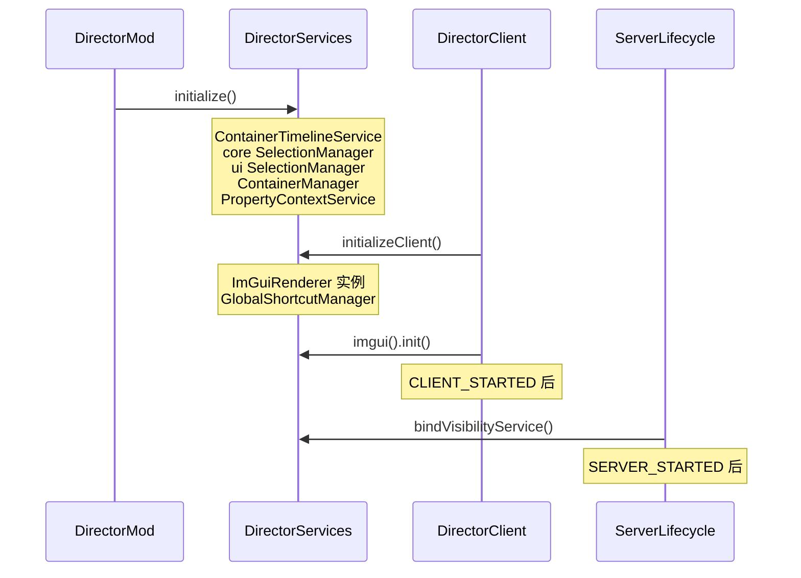

# Director 单例迁移总结

> 迁移周期：阶段 0–5（`ContainerManager` 契约修复 → `DirectorServices` 注册表）  
> 核心入口：`com.director.core.DirectorServices`  
> 批量迁移工具：`tools/migrate_to_director_services.py`

---

## 1. 背景与动机

### 原有问题

| 问题 | 说明 |
|------|------|
| 单例泛滥 | 约 **49** 个类定义 `getInstance()`，全项目 **600+** 处调用 |
| 与 DI 宣称矛盾 | `DirectorUIManager` 文档称「现代依赖注入」，实际仅 UI 面板局部 IoC |
| `ContainerManager` 可返回 `null` | `volatile boolean` + `Thread.sleep(10)` 轮询，主线程阻塞风险 |
| 空值处理不一致 | 同一服务：`requireNonNull` / 判空 / 无防护三种写法并存 |

### 目标

- **不**一次性引入 Spring/Guice（与 Fabric 生命周期不匹配）
- 建立 **Mod 级服务注册表**，新代码统一走 `DirectorServices`
- 旧 `getInstance()` 保留并 `@Deprecated`，分阶段迁移
- 核心服务：**显式初始化、契约清晰、永不静默返回 null**（可选服务除外）

---

## 2. 分阶段完成情况

### 阶段 0：契约修复（`ContainerManager`）

- 移除 `Thread.sleep` 轮询与懒加载 fallback
- `getInstance()` **永不返回 null**，未初始化抛 `IllegalStateException`
- `DirectorMod.onInitialize()` 中调用 `ContainerManager.initialize()`
- 构造时**先注册全局实例**，再加载默认容器/存档

### 阶段 1：`DirectorServices` 基础设施

- 新增 `com.director.core.DirectorServices`
- 首批注册：`ContainerManager`、`core.selection.SelectionManager`、`ContainerTimelineService`
- `PanelFactory`、`DirectorMod` 服务端生命周期改为走注册表

### 阶段 2：热点路径迁移

- 批量迁移容器/时间线/选区相关 **~87 个文件**
- 重点：`TimelineClipBlockController`、`ContainerCullTool`、`DirectorUIManager`、`PropertyAdapter` 等

### 阶段 3：UI 选择服务

- 注册 `ui.selection.SelectionManager` → `DirectorServices.uiSelection()`
- 与方块选区 `selection()` **明确区分**
- `PropertyContextService` 静态块改为 `initialize()`，避免引导顺序问题

### 阶段 4：生命周期服务

- **可见性**：`visibilityOrNull()`，`SERVER_STARTED` 后由 `ContainerServices.init()` 绑定
- **快捷键**：`globalShortcuts()`，客户端 `DirectorServices.initializeClient()` 后可用

### 阶段 5：`ImGuiRenderer`

- 实例在 `initializeClient()` 创建；`init()` 仍在 `CLIENT_STARTED`（需 OpenGL 上下文）
- 访问：`DirectorServices.get().imgui()` / `imguiOrNull()`

---

## 3. 初始化时序



### 调用入口

| 时机 | 调用方 | 方法 |
|------|--------|------|
| 模组通用端启动 | `DirectorMod` | `DirectorServices.initialize()` |
| 客户端启动 | `DirectorClient` | `DirectorServices.initializeClient()` |
| 客户端完全就绪 | `DirectorClient`（`CLIENT_STARTED`） | `DirectorServices.get().imgui().init()` |
| 服务器启动 | `DirectorMod`（`SERVER_STARTED`） | `ContainerServices.init()` → `bindVisibilityService()` |

---

## 4. `DirectorServices` API 一览

| 访问器 | 类型 | 初始化时机 | null 行为 |
|--------|------|-----------|-----------|
| `containers()` | `ContainerManager` | `initialize()` | 抛异常 |
| `selection()` | `core.selection.SelectionManager` | `initialize()` | 抛异常 |
| `uiSelection()` | `ui.selection.SelectionManager` | `initialize()` | 抛异常 |
| `containerTimeline()` | `ContainerTimelineService` | `initialize()` | 抛异常 |
| `visibilityOrNull()` | `ContainerVisibilityService` | `SERVER_STARTED` 后 | **可为 null** |
| `globalShortcuts()` | `GlobalShortcutManager` | `initializeClient()` | 抛异常 |
| `globalShortcutsOrNull()` | `GlobalShortcutManager` | 同上 | 可为 null |
| `imgui()` | `ImGuiRenderer` | `initializeClient()` | 抛异常 |
| `imguiOrNull()` | `ImGuiRenderer` | 同上 | 可为 null |

### 新代码推荐写法

```java
// 容器
DirectorServices.get().containers().getContainer(id);

// 方块选区
DirectorServices.get().selection().clearSelection();

// 编辑器选择（时间线/属性）
DirectorServices.get().uiSelection().selectTrack(track);

// 时间线-容器关联
DirectorServices.get().containerTimeline().getTimelineModel();

// 可见性（须判空）
var vis = DirectorServices.get().visibilityOrNull();
if (vis != null) { vis.hideContainer(c); }

// 客户端 UI
DirectorServices.get().imgui().updateDisplaySize();
DirectorServices.get().globalShortcuts().setContextEnabled(ctx, true);
```

---

## 5. 已废弃的遗留 API

以下仍可用，编译会有 deprecation 提示，**新代码请勿使用**：

| 类 | 废弃方法 | 替代 |
|----|----------|------|
| `ContainerManager` | `getInstance()` | `DirectorServices.get().containers()` |
| `core.selection.SelectionManager` | `get()` / `getInstance()` | `.selection()` |
| `ui.selection.SelectionManager` | `get()` / `getInstance()` | `.uiSelection()` |
| `ContainerTimelineService` | `getInstance()` | `.containerTimeline()` |
| `ContainerServices` | `visibility()` | `.visibilityOrNull()` |
| `GlobalShortcutManager` | `getInstance()` | `.globalShortcuts()` |
| `ImGuiRenderer` | `getInstance()` | `.imgui()` |

---

## 6. 引导层例外（仍使用 `getInstance()`）

以下位置**故意保留**对废弃 API 的调用，属于注册表自举或同级服务访问：

- `DirectorServices.initialize()` / `initializeClient()` — 组装实例
- `ContainerManager` 内部 — 调用 `ContainerTimelineService.getInstance()`、`SelectionManager.getInstance()`（避免 `DirectorServices` 尚未就绪时的循环依赖）
- `ContainerServices.syncLoadedHiddenContainers()` — 通过 `DirectorServices.get().containers()` 获取容器

---

## 7. 迁移规模（当前）

| 指标 | 数量（约） |
|------|-----------|
| 已纳入 `DirectorServices` 的服务 | **7** |
| 使用 `DirectorServices.get()` 的文件 | **~110** |
| 仍定义 `getInstance()` 的类 | **~52** |
| 尚未纳入注册表的单例 | **~45**（时间线播放控制器、Actor 系统、渲染器等） |

### 已迁移的主要域

- 容器生命周期与命令
- 方块选区工具链
- 时间线 UI / 属性面板 / 命令
- 容器可见性、快捷键、ImGui 入口

### 尚未迁移（低优先级 / 生命周期特殊）

| 类别 | 示例 |
|------|------|
| 时间线播放运行时 | `TimelineClipBlockController`、`TimelineCameraController`、`TimelineWeatherController` |
| Actor 系统 | `ActorGizmoController`、`ActorRuntimeController`、`PropRegistry` |
| 客户端渲染 | `SelectionRenderer`、`ToolPreviewManager`、`BlockVisualStateManager` |
| 其他 | `ClipboardManager`、`VideoExportManager`、`InputFocusManager` |

这些可在**触及相关模块时**按需加入注册表，无需一次性完成。

---

## 8. 批量迁移工具

```bash
python tools/migrate_to_director_services.py
```

脚本会：

1. 将 `ContainerManager.getInstance()` 等模式替换为 `DirectorServices` 访问器
2. 对含 `import com.director.core.selection.SelectionManager` 的文件替换 `SelectionManager.get()`
3. 对含 `import com.director.ui.selection.SelectionManager` 的文件替换 UI 选择 `get()`
4. 自动添加 `import com.director.core.DirectorServices`
5. **跳过**引导层文件（见脚本内 `SKIP_FILES`）

迁移后务必 **编译验证**：`./gradlew compileJava`

---

## 9. 命名与契约约定

### 两种 SelectionManager

| 全限定名 | 注册表方法 | 职责 |
|----------|-----------|------|
| `com.director.core.selection.SelectionManager` | `selection()` | 方块/世界选区、选择工具 |
| `com.director.ui.selection.SelectionManager` | `uiSelection()` | 轨道/片段/属性面板选择 |

切勿混用；代码审查时重点检查 import 路径。

### 可选服务命名

- 后缀 `OrNull()`：生命周期晚于 Mod 启动，调用方**必须判空**
- 无后缀：假定已初始化，未就绪抛 `IllegalStateException`

### 新单例纳入注册表 checklist

1. 添加 `initialize()`（幂等），去掉懒加载/轮询
2. `getInstance()` 标记 `@Deprecated`，未初始化抛有意义异常
3. 在 `DirectorServices` 增加字段与访问器
4. 在正确的生命周期入口调用 `initialize()` / `bindXxx()`
5. 更新 `migrate_to_director_services.py` 规则（如适用）
6. 更新本文档

---

## 10. 与 UI IoC 的关系

`ui.di.PanelFactory` / `UIPanelManager` 是**面板级**依赖注入，与 `DirectorServices` **互补**：

- `DirectorServices` — 跨面板、跨系统的 Mod 级单例服务
- `PanelFactory` — 面板构造与 `MinecraftClient` 注入

`ContainerPanel` 已通过构造函数注入 `ContainerManager`；`PanelFactory` 从 `DirectorServices.get().containers()` 获取实例，二者一致。

---

## 11. 后续建议

1. **按模块推进**：改动 Actor 系统时，将 `ActorGizmoController` 等纳入 `DirectorServices`
2. **避免回退**：新 PR 禁止新增无 `initialize()` 的懒单例
3. **文档同步**：`DirectorUIManager` 类注释可改为「面板级 IoC + Mod 级 `DirectorServices`」以反映现状
4. **可选增强**：为 `DirectorServices` 增加 `isInitialized()` / 调试 `dump()` 便于排查启动顺序问题

---

## 12. 相关文件

| 文件 | 作用 |
|------|------|
| `core/DirectorServices.java` | 服务注册表 |
| `DirectorMod.java` | 通用端 + 服务端生命周期 |
| `client/DirectorClient.java` | 客户端服务 + ImGui 初始化 |
| `core/container/ContainerManager.java` | 容器管理（阶段 0 契约） |
| `core/container/visibility/ContainerServices.java` | 可见性服务绑定 |
| `ui/properties/PropertyContextService.java` | 属性上下文（延迟监听注册） |
| `tools/migrate_to_director_services.py` | 批量迁移脚本 |
